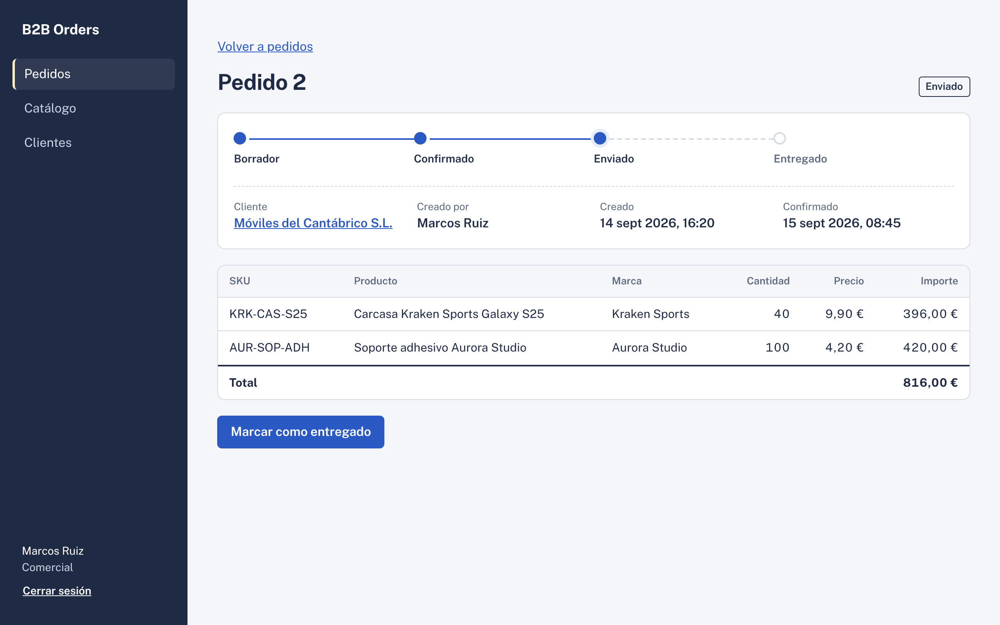
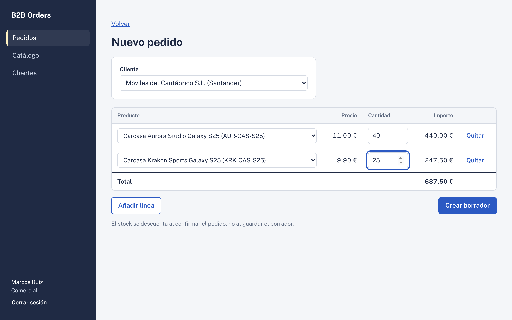
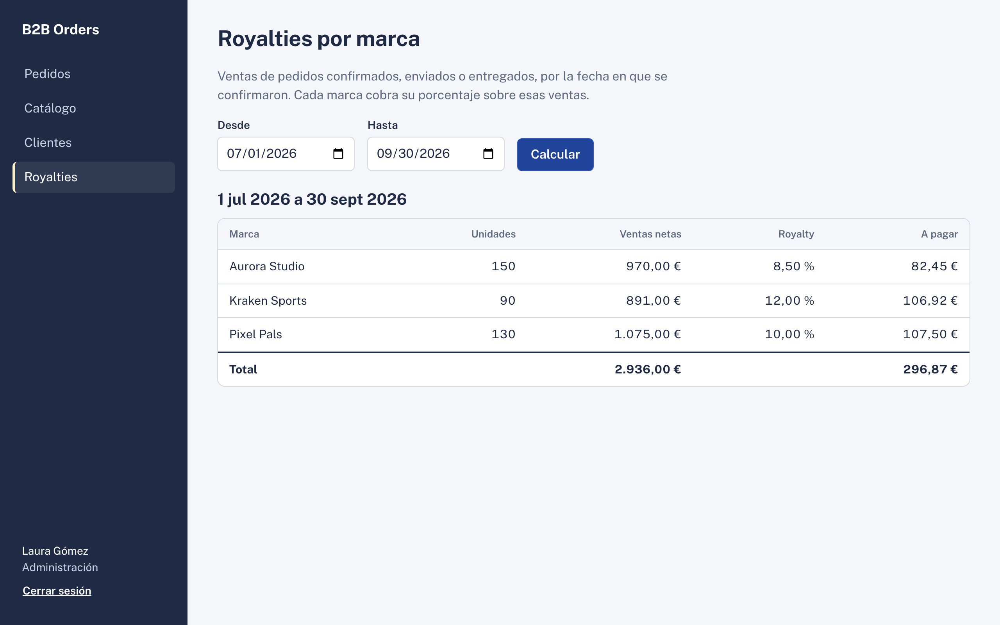
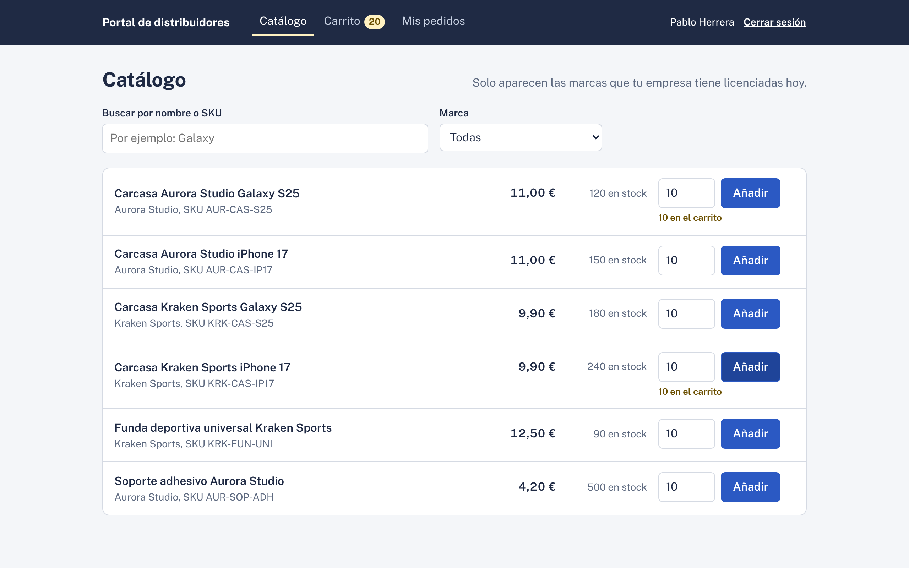
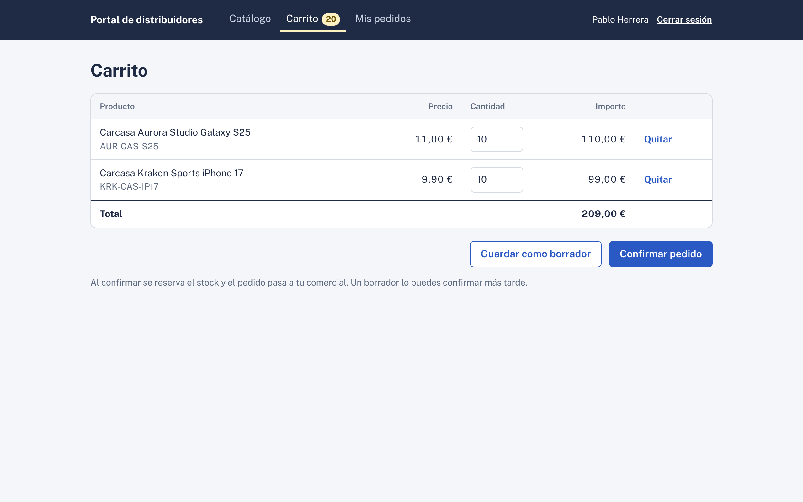
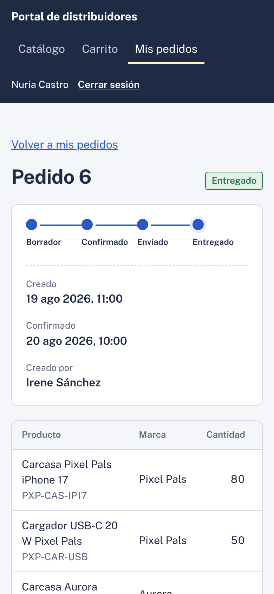

# B2B Orders

[](https://github.com/AlvaroDEVicente/b2b-orders/actions/workflows/ci.yml)

Antes de dedicarme al desarrollo trabajé en ventas B2B y gestión de licencias de marca para una empresa de accesorios de móvil. Este proyecto es una versión de aquel día a día: una distribuidora que vende productos con licencia (carcasas, fundas, cargadores) a tiendas y distribuidores.

La regla que manda en ese negocio es sencilla: un distribuidor solo puede vender una marca si tiene la licencia en vigor. A partir de ahí salen el resto de cosas: el catálogo que ve cada cliente, qué pedidos se pueden confirmar y cuánto se le paga a cada marca en royalties.

Hay una API y dos aplicaciones encima:

- un back-office en Angular para administración y comerciales;
- un portal en React para que los distribuidores hagan sus pedidos sin llamar a su comercial.

Las marcas y empresas de la demo son inventadas.

## Capturas

Back-office (Angular): detalle de un pedido, alta de un pedido por un comercial e informe de royalties.

 


Portal de distribuidores (React): catálogo, carrito y un pedido desde el móvil.

 


## Tecnologías

- API: Java 21, Spring Boot 4.1, Spring Data JPA, Spring Security con JWT, Flyway y PostgreSQL 17. Documentada con Swagger.
- Back-office: Angular 22 con componentes standalone, signals, formularios reactivos y RxJS.
- Portal: React 19 con TypeScript, React Router y TanStack Query, sobre Vite.
- Tests: JUnit 5, Mockito y Testcontainers en el backend; Vitest en Angular; Vitest y Testing Library en React.
- Docker Compose para levantarlo todo y GitHub Actions para la integración continua.

## Cómo arrancarlo

Solo hace falta Docker:

```bash
docker compose up --build
```

- Back-office: http://localhost:4200
- Portal de distribuidores: http://localhost:5173
- Swagger: http://localhost:8080/swagger-ui.html

Usuarios de prueba, todos con la contraseña `demo1234`:

| Usuario | Qué puede hacer |
| --- | --- |
| `admin@example.com` | Todo: catálogo, clientes, licencias y royalties |
| `marcos.comercial@example.com` | Comercial con dos clientes asignados |
| `cliente.cantabrico@example.com` | Cliente de Móviles del Cantábrico |
| `cliente.vera@example.com` | Cliente de TecnoVera |

El portal de React solo deja entrar a clientes.

Para programar con recarga en caliente lo arranco por partes:

```bash
cd backend && ./mvnw spring-boot:test-run   # API + PostgreSQL temporal con datos de prueba (necesita Docker)
cd frontend-angular && npm install && npm start
cd frontend-react && npm install && npm run dev
```

Si arrancas la API con `spring-boot:run` contra tu propio PostgreSQL, necesitas las variables `DB_URL`, `DB_USER`, `DB_PASSWORD` y `JWT_SECRET` (al menos 32 caracteres). Sin el secreto la API no arranca, a propósito.

## Cómo funciona

Un pedido pasa por borrador, confirmado, enviado y entregado, y se puede cancelar mientras está en borrador o confirmado. Al confirmarlo se vuelve a comprobar la licencia y se descuenta el stock de todas las líneas, o de ninguna si falta alguna. Si se cancela un pedido confirmado, el stock vuelve al almacén.

Cada usuario ve solo lo suyo: un comercial, sus clientes; un cliente, su empresa. Si alguien pide un registro que no es suyo, la API responde 404, como si no existiera.

Algunas decisiones que tomé:

- El esquema de la base de datos lo llevan las migraciones de Flyway. Hibernate solo comprueba que coincide.
- Las reglas del pedido están en la propia entidad `Order` y no repartidas por los servicios, así no hay forma de saltarse un estado.
- Al confirmar, las filas de los productos se bloquean con `SELECT ... FOR UPDATE`. Empecé con bloqueo optimista, pero un test con seis confirmaciones a la vez demostró que fallaban cinco aunque había stock de sobra. Con el bloqueo pesimista esperan su turno y salen todas.
- Los tests de integración usan un PostgreSQL real con Testcontainers en lugar de H2, y no hacen rollback entre tests. Así salió un error que con rollback habría quedado oculto: al editar las líneas de un pedido, Hibernate inserta antes de borrar y chocaba con una restricción `UNIQUE`.
- La API devuelve con cada pedido las acciones que el usuario puede hacer, y los fronts solo pintan esos botones. Las reglas están en un solo sitio.

## Lo que mejoraría

- El informe de royalties usa el porcentaje actual de cada marca. Si se cambia, cambian los informes pasados. Habría que guardar el porcentaje en cada línea al confirmar.
- Si administración edita un producto, el stock que envía pisa el de la base de datos, y un pedido confirmado justo en ese momento se pierde.
- Un token sigue siendo válido hasta que caduca (8 horas), aunque se desactive al usuario.
- No hay límite de intentos de inicio de sesión.

## Tests

```bash
cd backend && ./mvnw verify          # 60 tests, contra PostgreSQL real
cd frontend-angular && npm run test:ci   # 24 tests
cd frontend-react && npm test        # 17 tests
```

GitHub Actions pasa las tres baterías y construye las imágenes Docker en cada push a `main`.

## Estructura

```
backend/            API, organizada por funcionalidad (order/, product/, customer/...)
frontend-angular/   back-office
frontend-react/     portal de distribuidores
docs/               capturas y guía de despliegue en Railway
```
